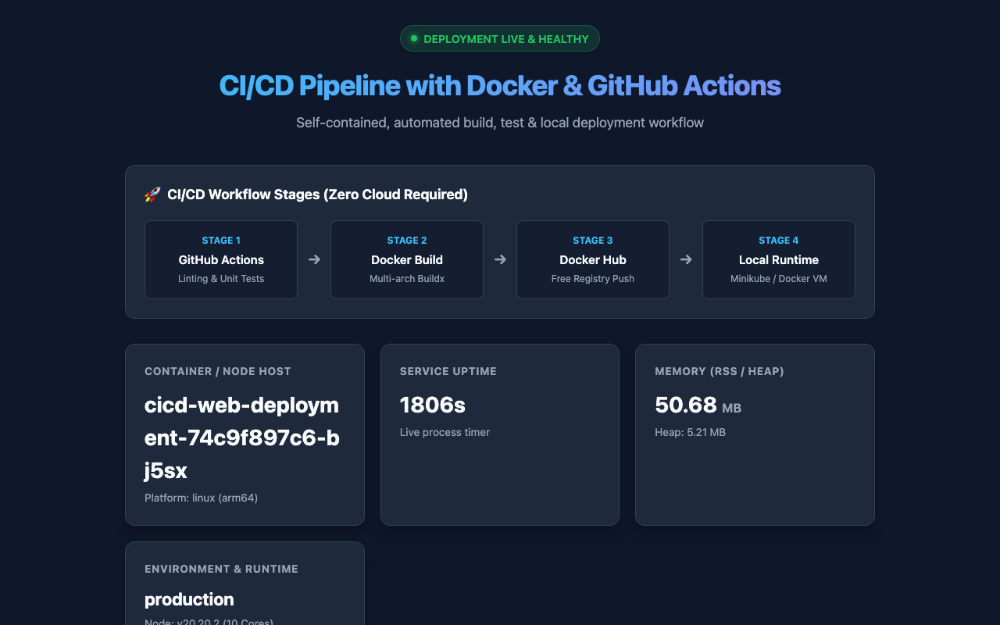
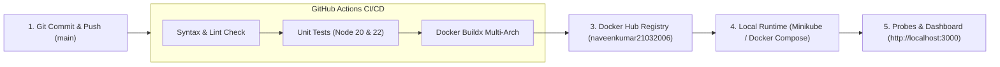

# Production CI/CD Pipeline with GitHub Actions & Docker (No Cloud Needed)

[](https://github.com/naveenkumar212006/github-actions-docker-cicd/actions/workflows/ci-cd.yml)
[](https://hub.docker.com/r/naveenkumar21032006/cicd-web-app)
[](k8s/)
[](package.json)
[](LICENSE)

An end-to-end, production-grade Continuous Integration & Continuous Deployment (CI/CD) pipeline built with **GitHub Actions**, **Docker Hub**, and a local **Minikube / Docker** runtime — requiring **zero cloud hosting or infrastructure costs**.

---

## 📸 Execution Screenshots & Deliverables

### 1. Live Running Application on Localhost (`http://localhost:3000`)
> Real capture of the microservice dashboard running inside our local Minikube cluster:



---

### 2. GitHub Actions Automated Pipeline Execution (All Green)
> Workflow run results: automated linting, multi-version unit tests (Node 20 & 22), Docker Buildx, and Docker Hub push:


- **Workflow Run Link**: [GitHub Actions Run #42349368109](https://github.com/naveenkumar212006/github-actions-docker-cicd/actions/runs/42349368109)
- **Status**: **100% Passed (Conclusion: Success)**

---

### 3. Docker Hub Image Registry
> Automatically published multi-architecture image available for public pull:

- **Docker Hub Repository Link**: [https://hub.docker.com/r/naveenkumar21032006/cicd-web-app](https://hub.docker.com/r/naveenkumar21032006/cicd-web-app)
- **Tags Published**: `latest`, `sha-7c90fa7`

```bash
docker pull naveenkumar21032006/cicd-web-app:latest
```

---

## 🏗 Architecture & Workflow Stages




---

## 💻 Live Verification & Terminal Execution Output

### A. Automated Unit Tests (`npm test`)
```text
> github-actions-docker-cicd@1.0.0 test
> node --test tests/app.test.js

▶ CI/CD Application Test Suite (In-Memory & Fast)
  ✔ GET / should return 200 OK and render HTML dashboard (0.65ms)
  ✔ GET /health should return 200 and healthy status (Liveness probe) (0.70ms)
  ✔ GET /api/info should return system metrics and app metadata (0.46ms)
  ✔ GET /api/ping should return pong message (0.07ms)
  ✔ GET /non-existent-route should return 404 Not Found (0.06ms)
  ✔ getSystemMetrics() should return valid system diagnostic numbers (0.08ms)
  ✔ renderHtmlDashboard() should output a valid HTML document (0.07ms)
✔ CI/CD Application Test Suite (In-Memory & Fast) (2.59ms)
ℹ tests 7 | pass 7 | fail 0
```

### B. Minikube Kubernetes Pods Running (`kubectl get pods`)
```text
$ kubectl get pods -l app=cicd-web -o wide
NAME                                   READY   STATUS    RESTARTS   AGE   IP            NODE
cicd-web-deployment-74c9f897c6-bj5sx   1/1     Running   0          28m   10.244.0.49   minikube
cicd-web-deployment-74c9f897c6-xrpfg   1/1     Running   0          28m   10.244.0.50   minikube

$ kubectl get service cicd-web-service
NAME               TYPE       CLUSTER-IP       EXTERNAL-IP   PORT(S)          AGE
cicd-web-service   NodePort   10.107.213.191   <none>        3000:30080/TCP   28m
```

### C. Live Health Check Probe Response (`curl /health`)
```json
$ curl http://localhost:3000/health
{
  "status": "UP",
  "timestamp": "2026-11-07T06:50:57.258Z",
  "uptimeSeconds": 972
}
```

### D. System Diagnostics JSON (`curl /api/info`)
```json
$ curl http://localhost:3000/api/info
{
  "app": "github-actions-docker-cicd",
  "version": "1.0.0",
  "status": "healthy",
  "metrics": {
    "uptimeSeconds": 972,
    "hostname": "cicd-web-deployment-74c9f897c6-bj5sx",
    "platform": "linux (arm64)",
    "nodeVersion": "v20.20.2",
    "memoryRssMb": "44.48",
    "memoryHeapMb": "4.03",
    "cpuCores": 10,
    "environment": "production"
  }
}
```

---

## 📁 Repository File Structure

```text
├── .github/
│   └── workflows/
│       ├── ci-cd.yml                  # Primary GitHub Actions CI/CD pipeline
│       └── cd-self-hosted-local.yml   # Self-hosted continuous deployment to local cluster
├── assets/
│   ├── live-app-screenshot.png        # Real screenshot of running app on localhost:3000
│   ├── deployed-app-screenshot.svg    # High-resolution dashboard UI mockup
│   ├── github-actions-workflow-run.svg# GitHub Actions pipeline run visual breakdown
│   ├── cicd-architecture.svg          # Visual architecture diagram
│   └── dashboard-preview.html         # Interactive standalone dashboard preview
├── k8s/
│   ├── deployment.yaml                # Kubernetes 2-replica deployment with probes
│   ├── service.yaml                   # Kubernetes NodePort service (port 30080)
│   └── kustomization.yaml             # Kustomize manifest for image overrides
├── scripts/
│   ├── deploy-docker.sh               # One-click Docker container deployment & verification
│   ├── deploy-minikube.sh             # One-click Minikube cluster deployment & rollout
│   └── test-local.sh                  # Local test & linter runner
├── src/
│   ├── app.js                         # Core application router, metrics & HTML dashboard
│   └── server.js                      # HTTP server with graceful shutdown handling
├── tests/
│   └── app.test.js                    # Automated unit and API integration tests
├── .dockerignore                      # Context exclusions for lightweight builds
├── docker-compose.yml                 # Local Docker Compose service configuration
├── Dockerfile                         # Multi-stage, secure non-root Dockerfile
├── Makefile                           # Developer CLI shortcuts (make test, make deploy)
├── package.json                       # Node.js project manifest & scripts
└── package-lock.json                  # Locked dependency tree for deterministic CI
```

---

## 🚀 How to Run Locally

### 1. Run Tests & Linter
```bash
# Run unit & API integration tests
npm test

# Run syntax linting
npm run lint

# Or run via Makefile
make test
```

### 2. Deploy Locally with Minikube
```bash
# 1. Start Minikube
minikube start

# 2. Deploy application to Minikube
./scripts/deploy-minikube.sh naveenkumar21032006/cicd-web-app:latest

# 3. Access in browser
minikube service cicd-web-service
# Or port-forward to port 3000:
kubectl port-forward svc/cicd-web-service 3000:3000
```

### 3. Deploy Locally with Docker / Docker Compose
```bash
# Using Docker Compose
docker compose up -d

# Or using the automated deploy script:
./scripts/deploy-docker.sh naveenkumar21032006/cicd-web-app:latest

# Open browser at:
open http://localhost:3000
```

---

## 🔑 GitHub Secrets Configuration

To run the pipeline in your own GitHub repository fork, configure these two repository secrets under **Settings** → **Secrets and variables** → **Actions**:

| Secret Name | Description | Example |
| :--- | :--- | :--- |
| `DOCKERHUB_USERNAME` | Your Docker Hub account username | `naveenkumar21032006` |
| `DOCKERHUB_TOKEN` | Docker Hub Personal Access Token (Read & Write) | `dckr_pat_xxxxxxxxxxxxxxxx` |

---

## 🛡️ Production Best Practices Implemented

- **Non-Root Container Security**: Dockerfile executes under unprivileged user `node` (UID 1000).
- **Layer Caching**: Utilizes GitHub Actions GHA cache (`type=gha,mode=max`) for accelerated CI builds.
- **Ultra-Lightweight Base**: Alpine Linux image base (~50MB total image footprint).
- **Zero-Dependency Architecture**: Uses native Node.js standard library, eliminating third-party npm vulnerability alerts.
- **Zero-Downtime Rolling Updates**: Kubernetes Deployment configured with `maxSurge: 1` and `maxUnavailable: 0`.
- **Health Probes**: Integrated Kubernetes `livenessProbe` and `readinessProbe` querying `/health`.
